# raspberry-generator
### procedural high-fidelity raspberry fields for Gazebo Harmonic (ROS 2 Jazzy)

A random raspberry field generator for agricultural robotics simulation. The
ROS 2 package is called `raspberry_field`. Each plant is generated from scratch
by a Blender script. There is no hand-made `.blend`
file: geometry, UVs, textures and materials are all code, and the same seed
always gives the same plant.

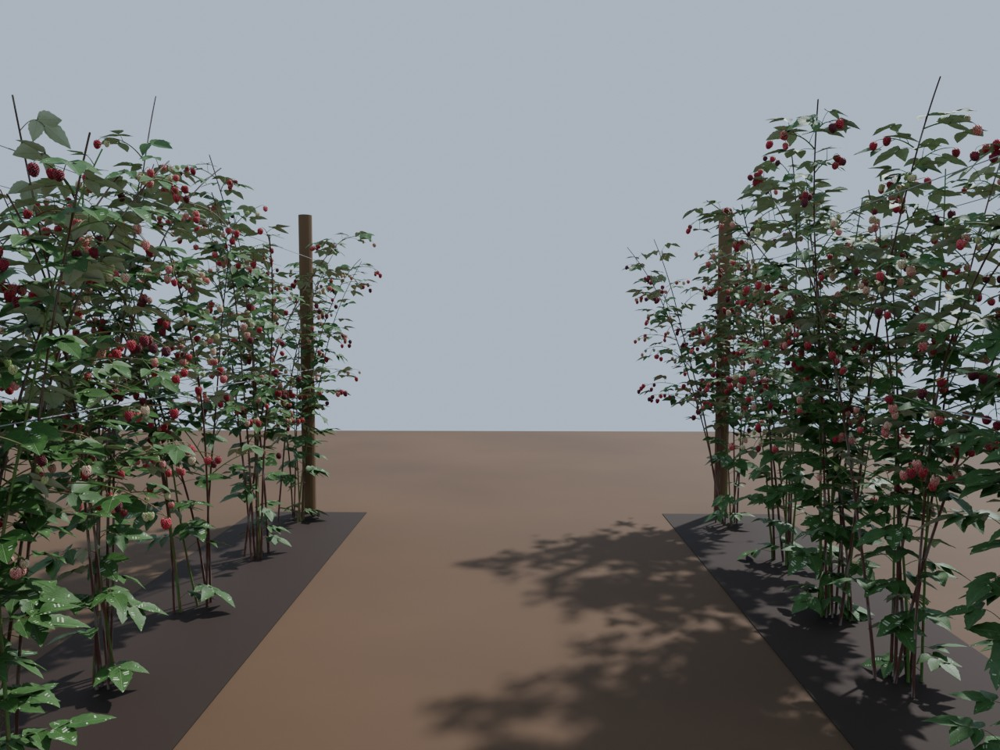

What a plant contains:
- **Crown of canes:** 4–7 brown, woody **floricanes** that carry fruit, plus
  2–5 green, leafy **primocanes**. Canes lean along the row like a hedgerow and
  carry prickles.
- **Fruiting laterals** on the upper ⅔ of the floricanes. Each lateral has
  trifoliate leaves and a fruit cyme at its tip, and the terminal fruit ripens
  first.
- **Compound leaves** with 3 or 5 leaflets. The leaflets have doubly serrate
  margins, a midrib fold and curl, a veined normal-mapped upper side and a pale
  underside.
- **Aggregate fruit.** Each fruit is made of 75–115 individual drupelets packed
  in a golden-angle spiral on a conical receptacle. It has a 5-sepal calyx that
  reflexes as the fruit ripens.
- **Ripeness stages:** flower / bud → green → white → pink → ripe → overripe.
  Colour comes from a fruit atlas, and the drupelets near the calyx lag behind
  the rest of the fruit.

## Repository layout

```
blender/raspberry_gen.py     Blender script: generates one plant model (meshes, textures, SDF, markers)
scripts/generate_field.py    builds a whole field world (runs Blender in parallel, writes world SDF + markers)
scripts/ground_truth.py      ROS 2 node: publishes markers.json as an RViz MarkerArray
scripts/render_preview.py    Blender script: renders preview images of a generated model or world
launch/field.launch.py       starts Gazebo Harmonic with a generated world
examples/*.sh                the three showcase examples below (generate + render)
docs/images/                 the showcase images
Dockerfile, docker/          ready-to-run image: ROS 2 Jazzy + Gazebo Harmonic + Blender (see Docker below)
```

## Quick start with Docker

If you don't have ROS 2 or Gazebo installed, the Docker image has everything
you need: ROS 2 Jazzy, Gazebo Harmonic 8, Blender 4.2 and this package,
already built. You only need Docker and a Linux desktop. All commands below
are run from the repository root.

### 1. Prerequisites
- [Docker Engine](https://docs.docker.com/engine/install/).
- An X11 or XWayland desktop session (most Linux desktops; WSLg on Windows
  also works).
- A GPU is optional but recommended:
  - **NVIDIA:** install the
    [NVIDIA Container Toolkit](https://docs.nvidia.com/datacenter/cloud-native/container-toolkit/latest/install-guide.html).
  - **Intel or AMD:** works out of the box through `/dev/dri`.
  - **No GPU:** uses software rendering. The GUI works but slowly, and
    `snapshot` won't work.

### 2. Build the image (once, about 10 min, about 8 GB)
```bash
docker build -t raspberry-generator .
```

### 3. See a raspberry field in Gazebo
```bash
./docker/run.sh demo
```
`demo` generates a small field the first time you run it (2 rows × 4 plants,
which takes a few seconds) into `./generated/demo_field`. It then opens it in
Gazebo with the simulation already playing. Later runs open the existing field
straight away.

To move around the scene:
- left-drag pans
- scroll zooms
- right-drag zooms
- shift + left-drag (or middle-drag) orbits

Right-click a plant and choose **Move to** to fly to it. To see the berries up
close, zoom in on the upper half of the canes.

`docker/run.sh` is a thin wrapper around `docker run`. It:
- lets the container use your display (`xhost +local:root`)
- detects your GPU (`GPU=nvidia|dri|none` overrides it)
- mounts `./generated` as `/data` (`DATA_DIR=...` changes it)
- runs Gazebo in its own transport partition, so it doesn't talk to other
  Gazebo instances on your machine

Files are written with your user id, not as root.

### 4. Generate your own field
`generate` takes all the `generate_field.py` options, plus plant options
after `--` (see [Generate a field](#generate-a-field)):

```bash
# 4 rows x 10 plants, early-season look, light meshes
./docker/run.sh generate --world_name my_field --rows 4 --plants_per_row 10 --seed 42 \
    -- --detail low --ripeness 0.4

# open it in Gazebo (the name is the --world_name you used)
./docker/run.sh sim my_field
```

The world appears on your machine in `./generated/my_field/`. It holds the
world SDF, one folder per plant model, and `markers.json` with the
ground-truth position, stage and size of every fruit.

To get exactly the trellised field from [example 3](#3-trellised-field-examples03_trellis_fieldsh):
```bash
./docker/run.sh generate --world_name trellis_field --rows 3 --plants_per_row 6 --seed 3 \
    -- --detail low --ripeness 0.65
./docker/run.sh sim trellis_field
```

### 5. Get camera and segmentation images without the GUI
`snapshot` runs Gazebo headless. It adds an RGB camera and a semantic
segmentation camera at robot height between the first two rows, and saves
real Gazebo frames to `./generated/<world>/snapshots/`. This works on a
server with a GPU and no display.

```bash
./docker/run.sh snapshot demo_field
```

| `snapshots/rgb.png` (Gazebo camera) | `snapshots/segmentation_colored.png` (Gazebo segmentation camera) |
|---|---|
| 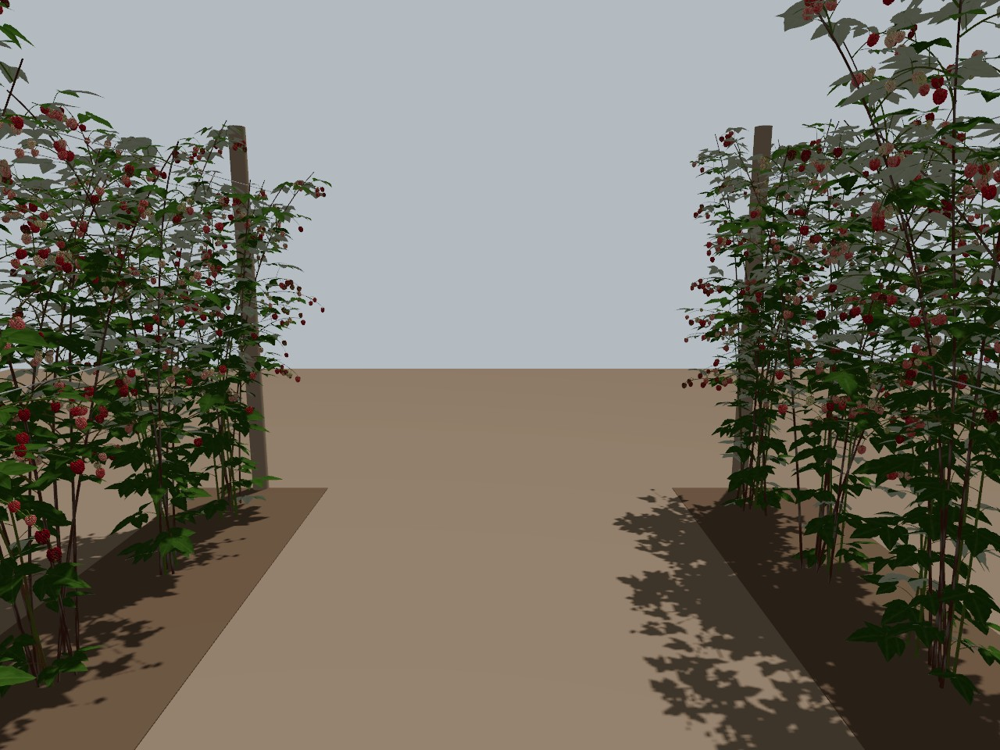 | 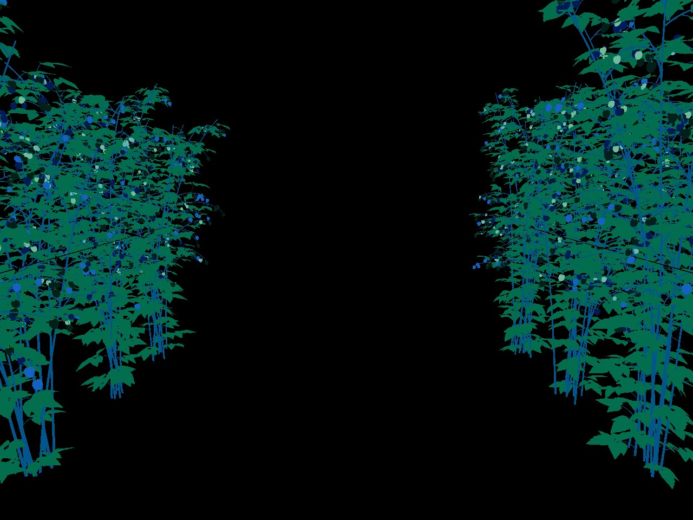 |

These images come from Gazebo Harmonic itself, not from Blender. The colours
in the segmentation image are Gazebo's own, one per label. In
`segmentation_labels.png`, each pixel holds the raw label id: 10 canes,
11 leaves, 12 calyx, 20 flowers, and 21–25 for the fruit stages green to
overripe.

### 6. Use it from ROS 2
`sim` and `demo` start the full launch file. That includes the `/clock`
bridge and the ground-truth publisher. The container uses host networking, so
the topics are visible from a second container or from a ROS 2 Jazzy install
on the host:

```bash
./docker/run.sh bash        # a second terminal with ROS 2 sourced
ros2 topic list             # /clock, /raspberry_field/ground_truth, ...
rviz2                       # Fixed Frame: world, Add -> MarkerArray -> /raspberry_field/ground_truth
```

To add your robot, spawn it into the running world as usual, for example with
`ros2 run ros_gz_sim create`. You can also extend the image
(`FROM raspberry-generator`) with your robot's packages.

### Container commands
| command | what it does |
|---|---|
| `demo` | generate (once) and open a small demo field |
| `generate [opts] [-- plant opts]` | generate a world into `./generated/<world_name>` |
| `sim [world_name] [launch args]` | open a generated world in Gazebo (default `raspberry_field`) |
| `snapshot <world_name>` | headless Gazebo RGB + segmentation images |
| `render <world_name>` | Blender preview renders (no GPU or display needed) |
| `bash`, or any other command | run it with ROS 2 sourced |

### Troubleshooting
- **`could not connect to display` / `cannot open display`:** make sure
  `echo $DISPLAY` prints something, and run `xhost +local:root` yourself if
  the `xhost` tool isn't installed. Undo it afterwards with
  `xhost -local:root`.
- **Gazebo window is black or crashes on start:** try forcing a GPU mode,
  for example `GPU=dri ./docker/run.sh demo`, or `GPU=none` for software
  rendering.
- **`snapshot` says "no frames rendered":** headless rendering needs a GPU
  (NVIDIA or `/dev/dri`). Use `render` for GPU-less previews.
- **Big fields are slow:** generate with `-- --detail low`, and/or use
  `--variants 4` to reuse 4 plant models across the field.

## Examples

Each example is a script in [`examples/`](examples/). It runs the generator
with the parameters shown, then renders the result with
`scripts/render_preview.py`. The renderer re-imports the exported `.glb`
files, so the images show exactly the meshes Gazebo loads. Set `BLENDER` if
Blender isn't on your `PATH`:

```bash
BLENDER=/path/to/blender ./examples/01_harvest_plant.sh
```

The generated models go to `generated/`, which is git-ignored because the
meshes are large (60–350 MB per example). Only the images are committed. All
seeds are fixed, so re-running a script reproduces the same plant or field
and the same images.

### 1. Harvest-time plant (`examples/01_harvest_plant.sh`)

One plant at maximum detail in the middle of the picking season:

```bash
blender -b --factory-startup --python blender/raspberry_gen.py -- \
    --model_dir generated/harvest_plant --seed 7 --detail high --ripeness 0.7
```

- `--ripeness 0.7` centres the season on "turning ripe". The default
  `--ripeness_spread 0.3` then spreads the fruits over every stage. This plant
  has 295 fruits: 13 green, 35 white, 80 pink, 119 ripe and 47 overripe, plus
  1 late flower.
- `--detail high` gives each drupelet a 10×6 sphere, 30×7 leaflets and 1024 px
  textures. That comes to 4.1 M triangles and 123 MB of `.glb`.

| whole plant (`plant` view) | fruit cluster (`cluster` view) |
|---|---|
| 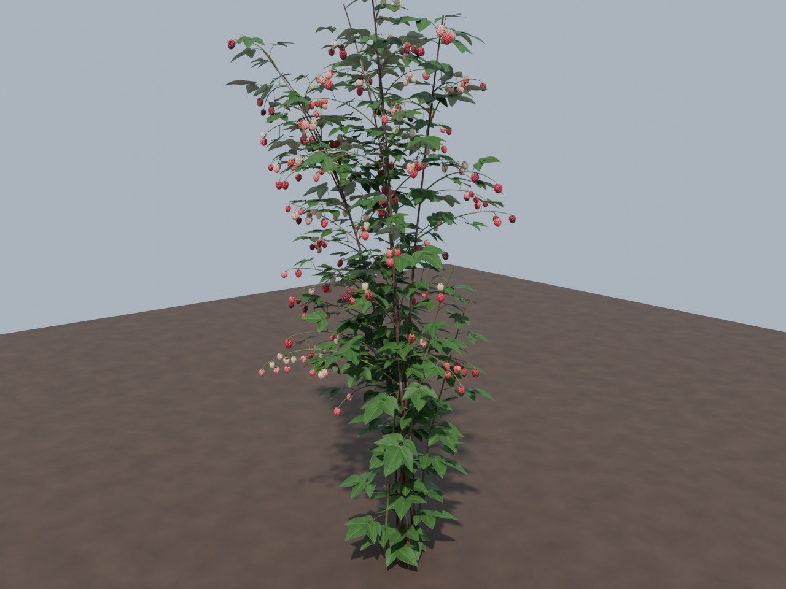 | 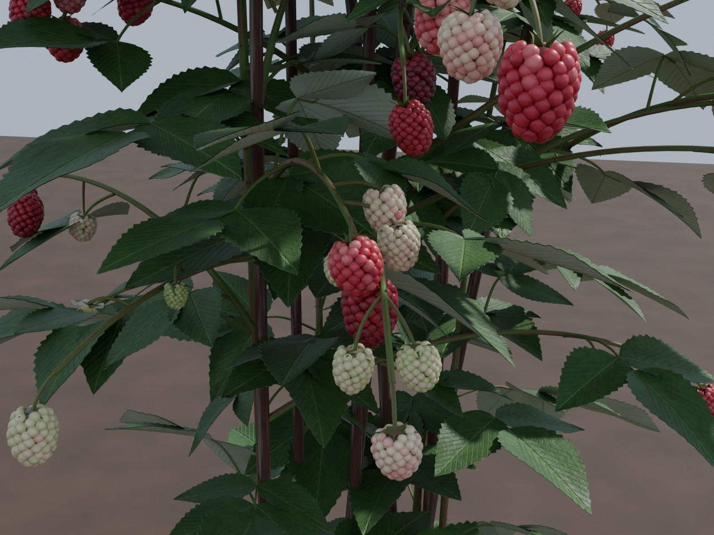 |

| drupelet macro (`fruit` view) | gz segmentation labels (`labels` view) |
|---|---|
| 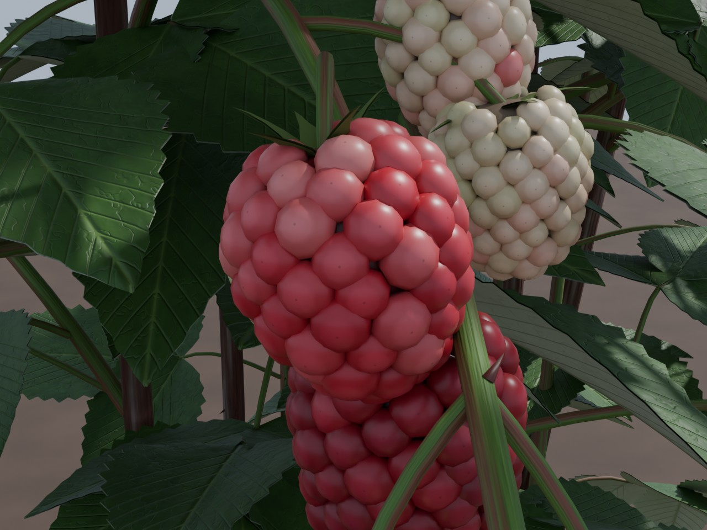 | 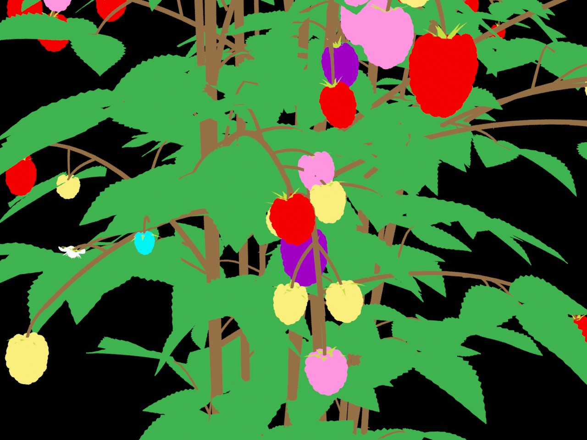 |

What to look for:
- **Cluster view:** ripeness differs within one lateral. Terminal fruits are
  ahead of the axillary ones, and green, white, pink, red and dark overripe
  berries hang side by side.
- **Macro view:** each berry is built from individual drupelets. The calyx is
  reflexed, and on some fruits the drupelets near the calyx are still paler.
- **Labels view:** each part is coloured by the gz `Label` id it carries in
  `model.sdf`. This is what a Gazebo segmentation camera separates:
  canes 10 (brown), leaves 11 (green), calyx 12 (yellow-green),
  fruit_green 21 (cyan), fruit_white 22 (yellow), fruit_pink 23 (pink),
  fruit_ripe 24 (red) and fruit_overripe 25 (purple).

### 2. Early season (`examples/02_early_season.sh`)

The same generator, moved earlier in the season:

```bash
blender -b --factory-startup --python blender/raspberry_gen.py -- \
    --model_dir generated/early_season --seed 21 --detail high --ripeness 0.0 --ripeness_spread 0.2
```

- `--ripeness 0.0` sits right at the flower/fruit boundary, and the narrower
  `--ripeness_spread 0.2` keeps the plant there. The result has 41 buds,
  74 open flowers, 93 green fruits and 7 white ones, and nothing ripe.
- Green fruits are generated smaller than ripe ones, and their calyx hugs the
  fruit instead of folding back.

| whole plant | flowers and green fruit | segmentation labels |
|---|---|---|
| 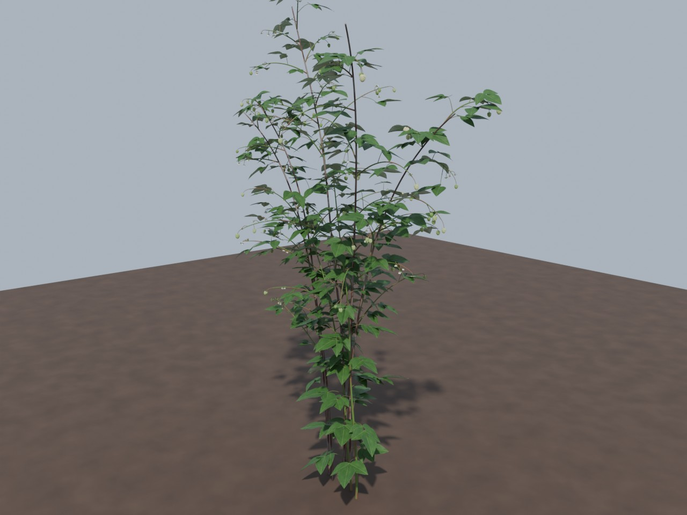 | 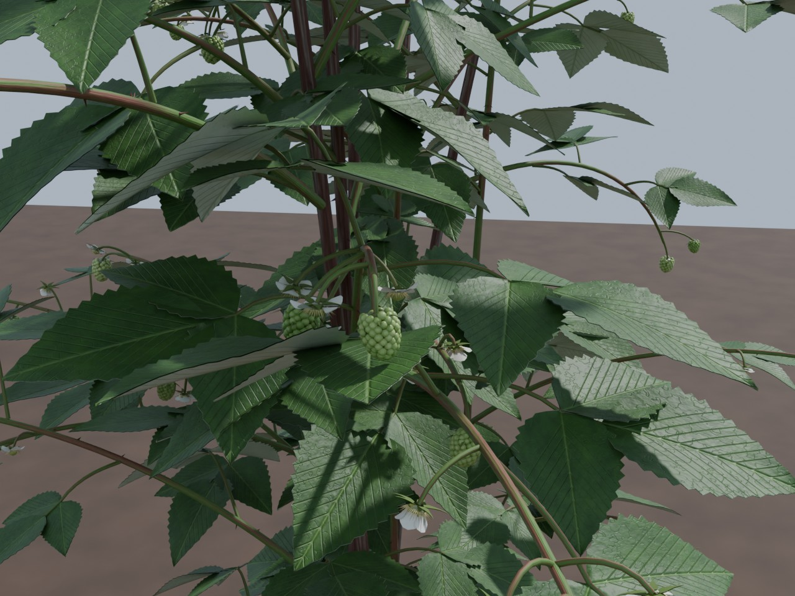 | 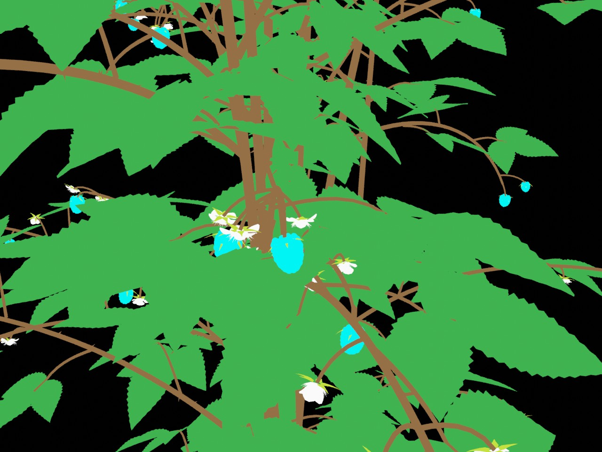 |

In the labels view, the flowers carry label 20 (white) and the green fruitlets
carry label 21 (cyan). So the same plant gives training data for flower
detection or bloom counting.

### 3. Trellised field (`examples/03_trellis_field.sh`)

A complete Gazebo world, ready for `field.launch.py`:

```bash
python3 scripts/generate_field.py --out generated --world_name trellis_field \
    --rows 3 --plants_per_row 6 --seed 3 -- --detail low --ripeness 0.65
```

- `--rows 3 --plants_per_row 6` gives 18 unique plants, using the default
  2.5 m row spacing and 0.6 m plant spacing. Each plant gets a small position
  jitter and is flipped or rotated by a random yaw.
- The world also contains wooden trellis posts, two pairs of wires per row at
  0.9 m and 1.5 m, and dark mulch strips under the rows. Use `--no_trellis` to
  leave these out.
- `--detail low` keeps the world light enough for real-time simulation: about
  0.4–0.8 M triangles per plant.
- The world-frame `markers.json` holds 4418 fruit and flower ground-truth
  entries: 276 green, 650 white, 1148 pink, 1728 ripe, 608 overripe and
  8 flowers. Each entry carries its `plant_id`.

| overview (`overview` view) | robot's-eye view between rows 1 and 2 (`row` view) |
|---|---|
| 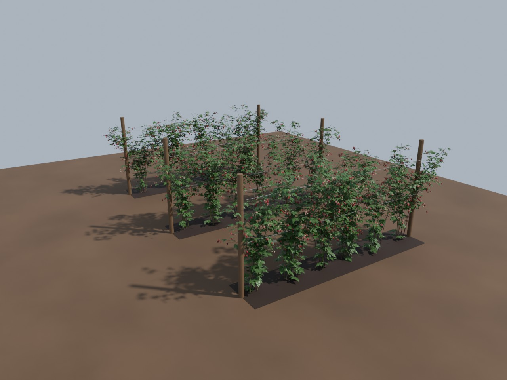 |  |

Run it in Gazebo with:
```bash
ros2 launch raspberry_field field.launch.py world_dir:=$PWD/generated/trellis_field world:=trellis_field.sdf
```

### Rendering your own previews

```bash
blender -b --factory-startup --python scripts/render_preview.py -- \
    --model_dir generated/<plant> --out docs/images/<name> --views plant,cluster,fruit,labels --focus ripe
blender -b --factory-startup --python scripts/render_preview.py -- \
    --world_dir generated/<world> --out docs/images/<name> --views overview,row
```
`--focus` picks which stage the close-ups look at, for example `ripe`, `pink`
or `flower`. The renderer picks an outer, crowded fruit of that stage and
ray-casts to make sure nothing blocks the view of it.

## Outputs

```
<world_dir>/
  raspberry_field.sdf        world: sun, soil, mulch strips, trellis posts + wires, plants
  markers.json               world-frame ground truth (PLANT / FRUIT / FLOWER)
  raspberry_N/
    model.sdf, model.config
    meshes/<part>.glb        canes, leaves, calyx, flowers, fruit_<stage>
    materials/textures/*.png
    markers.json             plant-frame ground truth
```

Each part is its own `<visual>` with a `gz::sim::systems::Label` plugin, so a
Gazebo **segmentation camera** gives per-class masks straight away:

| label | part | label | part |
|---|---|---|---|
| 10 | canes, laterals, petioles, pedicels | 21 | fruit_green |
| 11 | leaves | 22 | fruit_white |
| 12 | calyx (sepals) | 23 | fruit_pink |
| 20 | flowers | 24 | fruit_ripe |
| | | 25 | fruit_overripe |

Each fruit marker records: `translation` (fruit centre), `attach_point`
(pedicel junction, useful for picking), `axis`, `length`, `diameter`, `stage`,
`ripeness`, `drupelets` and `plant_id`.

## Requirements
(Not needed with [Docker](#quick-start-with-docker).)
- Blender ≥ 3.6 (tested with 4.2 LTS). It's only needed to *generate* worlds.
- ROS 2 Jazzy + Gazebo Harmonic (`ros-jazzy-ros-gz`) to run them.

## Build
```bash
cd ~/ros2_ws/src && git clone https://github.com/VicenteQueiroz/raspberry-generator.git
cd ~/ros2_ws && colcon build --packages-select raspberry_field && source install/setup.bash
```

## Generate a field
```bash
ros2 run raspberry_field generate_field.py --out ~/fields --rows 3 --plants_per_row 6 --seed 1 \
    -- --detail medium --ripeness 0.7
# or without ROS: python3 scripts/generate_field.py ... (stdlib only)
```
Field options: `--rows`, `--plants_per_row`, `--row_spacing` (2.5 m),
`--plant_spacing` (0.6 m), `--variants N` (generate N models and reuse them;
this saves GPU memory), `--jobs`, `--blender PATH` (or `$BLENDER`), and
`--no_trellis`.

Plant options go after `--`:

| option | default | meaning |
|---|---|---|
| `--detail low/medium/high` | medium | drupelet / leaf / tube resolution and texture size |
| `--ripeness` | 0.7 | season progress: <0 flowers, 0.3 green, 0.7 mixed, 1.0 overripe |
| `--ripeness_spread` | 0.3 | per-fruit variation |
| `--height` | 1.7 | floricane height [m] |
| `--floricanes`, `--primocanes` | random | cane counts |
| `--fruit_density`, `--leaf_density` | 1.0 | multipliers |
| `--prickles` | 1.0 | 0 = thornless cultivar |
| `--fruit_collisions` | off | add a static sphere collision per fruit |

Use a single plant directly:
`blender -b --factory-startup --python blender/raspberry_gen.py -- --model_dir out/raspberry_0 --seed 42`

**Budget.** A plant has roughly 200–400 fruits. Its exported triangle count
is about 0.4–0.8 M at `low`, 1.1–1.3 M at `medium` and about 4 M at `high`. For large
fields, use `--detail low` and/or `--variants`.

## Run
```bash
ros2 launch raspberry_field field.launch.py world_dir:=$HOME/fields/raspberry_field
```
This starts `gz sim` with the world dir on `GZ_SIM_RESOURCE_PATH`, a `/clock`
bridge, and `ground_truth.py`. The ground-truth node publishes a latched
`visualization_msgs/MarkerArray` on `/raspberry_field/ground_truth` in frame
`world`, with fruit spheres coloured by stage. Spawn your robot into the world
as usual.

## Notes
- The meshes are written to glTF with **Z-up data** (`export_yup=False`),
  which is what Gazebo's Assimp loader expects. This has been checked in
  Gazebo Harmonic 8.15 (see the `snapshot` images above). If plants show up
  lying on their side in another Gazebo version, regenerate with
  `-- --gltf_yup`.
- Leaves are real two-sided geometry (0.3 mm thick) rather than alpha cards,
  because Gazebo ignores glTF `doubleSided`.

## Credits

This project is based on
[**fields-ignition**](https://github.com/azazdeaz/fields-ignition) by András
Polgár ([@azazdeaz](https://github.com/azazdeaz)), a random tomato field
generator for ROS 1 Noetic and Ignition Gazebo. The overall idea and pipeline
come from that project: generate plants with the Blender Python API, assemble
them into a world, and export per-plant and world-level `markers.json` ground
truth. This repository replaces the tomato models with a fully procedural
raspberry generator and moves the stack to ROS 2 Jazzy and Gazebo Harmonic.

## License

MIT. See [LICENSE](LICENSE), which keeps the original fields-ignition copyright notice.
